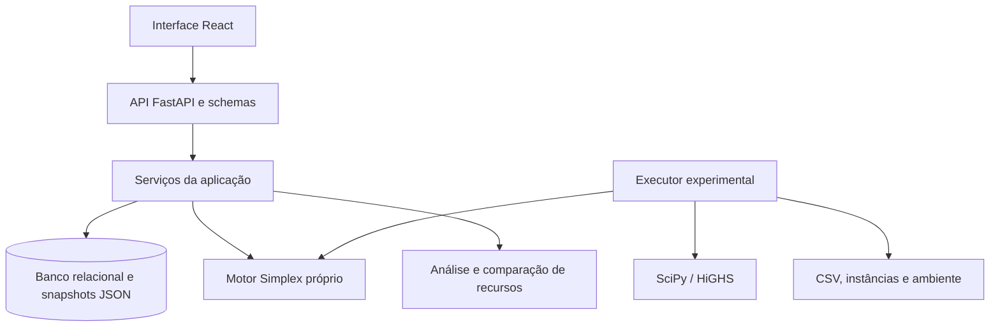
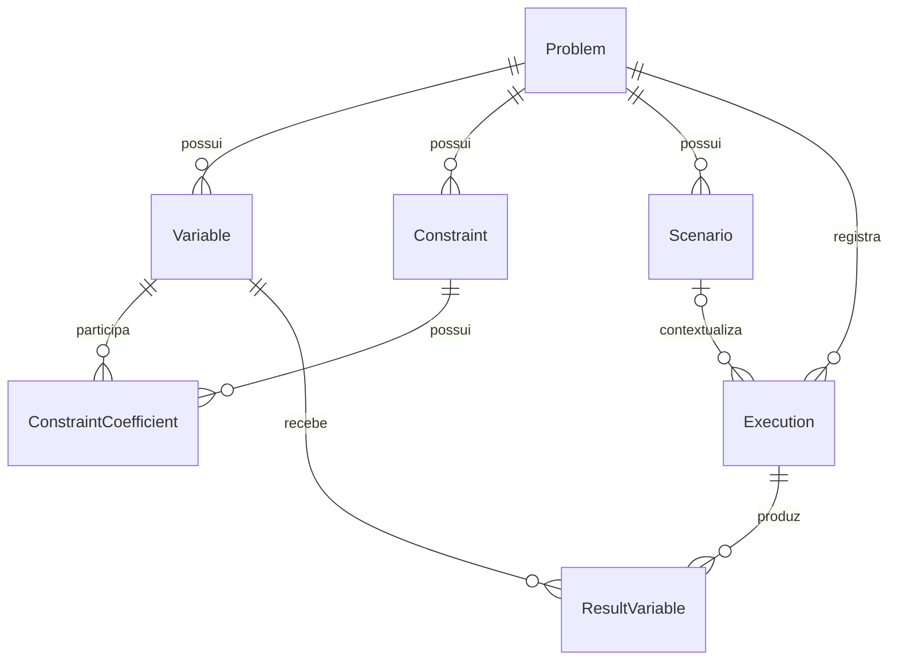

# TCC Otimizador — consolidação acadêmica

Data de consolidação: 16 de setembro de 2026. Este documento reúne evidências da implementação e da execução experimental local. Não representa avaliação de usuários, implantação em produção ou confirmação dos dados originais do caso dos feixes de mola. As referências ao final apontam para os artefatos do projeto; a fundamentação bibliográfica do TCC deve ser incorporada separadamente, com fontes efetivamente consultadas.

## 1. Objetivo e contribuição

O projeto desenvolve um sistema web de apoio à decisão baseado em programação linear contínua. A aplicação permite cadastrar modelos, construir cenários com alterações de parâmetros, executar um motor Simplex próprio, preservar resultados e interpretar o uso dos recursos por meio de tabelas, gráficos e comparações históricas.

A contribuição demonstrada combina a implementação de um algoritmo de otimização com uma aplicação que registra o contexto matemático das decisões. O sistema apoia a análise de alternativas; não decide automaticamente sobre investimentos nem comprova melhoria operacional em uma organização real.

Uma questão de pesquisa compatível com as evidências é: **em que medida um motor Simplex próprio, integrado a um sistema de cenários rastreáveis, produz soluções consistentes com um solver de referência e permite interpretar alternativas de alocação de recursos?** Essa formulação é uma proposta para a redação, não a declaração de um protocolo originalmente registrado.

## 2. Arquitetura

| Camada | Tecnologias e componentes | Responsabilidade |
|---|---|---|
| Apresentação | React, TypeScript, Vite e React Router | Cadastro, cenários, histórico, gráficos e análise de recursos |
| API | FastAPI e schemas Pydantic | Contratos de entrada/saída, validação e respostas HTTP |
| Serviços | Serviços de problemas, cenários, otimização, gestão e recursos | Preparação dos modelos, execução, snapshots e regras de comparação |
| Persistência | SQLAlchemy e Alembic; PostgreSQL configurado | Entidades relacionais, transações e evolução do esquema |
| Núcleo matemático | `SimplexDuasFases`, versão registrada 1.0.0; NumPy | Resolução da programação linear sem dependência da aplicação |
| Validação e experimentos | pytest, SciPy/HiGHS e geradores com sementes | Testes, comparação numérica e medição de desempenho |

O serviço de otimização converte o problema ou snapshot em A, b, c e operadores. Limites superiores e limites inferiores positivos são convertidos em restrições adicionais; a não negatividade pertence ao domínio do motor. Após a resolução, a aplicação registra status, objetivo, valores das variáveis, iterações, duração e versão do solver. A análise de recursos consulta o snapshot da execução, sem executar novamente o algoritmo.

Essa separação facilita testar o motor isoladamente e evoluir a interface. Como contrapartida, a aplicação precisa manter coerência entre dados relacionais, snapshots e conversão matemática. O HiGHS é uma referência dos experimentos: a execução normal da aplicação chama o motor próprio, não oferece atualmente seleção de solver.

## 3. Modelo de dados e preservação histórica

| Entidade | Conteúdo principal | Relacionamentos |
|---|---|---|
| Problem | Nome, descrição, sentido do objetivo e criação | Possui variáveis, restrições, cenários e execuções |
| Variable | Nome, coeficiente objetivo e limites | Pertence a um problema |
| Constraint | Nome, operador e RHS | Pertence a um problema |
| ConstraintCoefficient | Valor de aᵢⱼ | Associação restrição–variável, com chave composta |
| Scenario | Nome, descrição, criação e `model_snapshot` JSON | Pertence a um problema; pode ter várias execuções |
| Execution | Status, objetivo, duração, iterações, versão, criação e `analysis_snapshot` | Pertence a um problema e, opcionalmente, a um cenário |
| ResultVariable | Valor numérico obtido | Associação execução–variável, com chave composta |

O modelo-base é normalizado. Cada cenário guarda uma cópia matemática completa, incluindo coeficientes, operadores e limites. Cada nova execução guarda o modelo e os valores por nome no `analysis_snapshot`, preservando a base da análise histórica. O armazenamento redundante aumenta o volume de dados, mas reduz a dependência de parâmetros atuais para interpretar resultados antigos.

As alterações matemáticas são salvas em novos cenários; a edição de metadados altera nome e descrição. A duplicação copia o snapshot, sem copiar execuções. A aplicação bloqueia exclusão de problemas ou cenários que possuam execuções. Essas proteções são regras dos serviços, não um mecanismo de armazenamento inviolável: alterações diretas no banco exigem controles adicionais.

Execuções anteriores à introdução de `analysis_snapshot` podem não disponibilizar análise de recursos. O sistema não reconstrói uma suposta entrada histórica com os parâmetros atuais. A consulta histórica por execução identifica precisamente o resultado; não deve ser confundida com uma consulta à última execução do cenário.

## 4. Metodologia

### 4.1 Caracterização e desenvolvimento

Para a redação, o trabalho pode ser caracterizado como pesquisa aplicada, com desenvolvimento de um artefato computacional e avaliação quantitativa experimental. A classificação deve ser ajustada às orientações metodológicas da instituição. Não houve, nas evidências reunidas, ensaio de campo ou estudo de usabilidade com participantes.

O procedimento implementado compreende: formulação de modelos; resolução por Simplex em duas fases; integração à API e persistência; criação de cenários; análise de recursos; testes automatizados; e confronto com HiGHS. O motor trata minimização e maximização, operadores ≤, ≥ e = e variáveis contínuas não negativas. Emprega regra de Bland e possui tolerância padrão de 1e-9 e limite configurado de 10.000 iterações no procedimento iterativo. Estados de erro numérico e limite de iterações não são confundidos com solução ótima.

### 4.2 Interpretação dos recursos

Para a restrição i, LHSᵢ = Σⱼ aᵢⱼxⱼ e RHSᵢ = bᵢ. O residual é LHSᵢ − RHSᵢ. Para ≤, folga = RHS − LHS; para ≥, excesso = LHS − RHS. Nas igualdades, folga e excesso não se aplicam. Valores negativos são preservados para revelar violações.

A análise usa tolerância `1e-7 + 1e-9 × max(|LHS|, |RHS|)` para atividade e factibilidade. Essa tolerância pertence à análise da aplicação e difere do critério absoluto empregado no experimento dos solvers.

A utilização percentual é `100 × LHS/RHS` somente para capacidades ≤ com RHS positivo, coeficientes e valores envolvidos não negativos e ao menos um coeficiente positivo. Nos demais casos fica sem valor. Uma capacidade ativa é marcada como potencial gargalo somente quando toda a solução é factível. Restrições ativas redundantes podem não limitar melhorias; não são calculados preços-sombra.

Na comparação, deltas são cenário comparado menos referência. A classificação de melhoria considera o sentido do objetivo e somente é atribuída a funções objetivo compatíveis. Alterar simultaneamente custos e recursos impede atribuir causalidade exclusiva à capacidade.

### 4.3 Protocolo experimental

Foram avaliadas 152 instâncias: 35 factíveis limitadas, 35 factíveis com restrições mistas, 15 inviáveis, 15 ilimitadas, 50 de escala e dois casos de aplicação. A escala contém dez instâncias por tamanho: 5, 10, 20, 50 e 100 variáveis. Cada problema de escala tem 2n restrições geradas e n limites superiores explícitos, totalizando 3n restrições reais.

Cada solver recebeu um aquecimento por instância, seguido de cinco repetições medidas, com ordem alternada. Foram registrados 760 pares de amostras medidas. As repetições caracterizam o tempo de uma mesma entrada; não são 760 problemas independentes.

Sejam Zₚ o objetivo do motor próprio e Zₕ o do HiGHS:

- Erro absoluto: |Zₚ − Zₕ|.
- Erro relativo convencional: |Zₚ − Zₕ| / |Zₕ|, somente quando Zₕ ≠ 0.
- Erro normalizado: |Zₚ − Zₕ| / max(1, |Zₕ|).

A aprovação exige o status esperado em ambos os solvers e, para ótimos, erro normalizado ≤ 1e-7 e factibilidade independente dos dois vetores com tolerância absoluta de 1e-7. Todas as repetições devem passar. Não se exige igualdade dos vetores, pois podem existir ótimos alternativos. Casos inviáveis e ilimitados não recebem erro de objetivo. Dois erros coincidentes também não aprovam uma instância.

O cronômetro mede a chamada às interfaces Python, incluindo conversões e adaptadores, mas excluindo geração, HTTP, interface, banco e escrita dos arquivos. Os resumos utilizam medianas de tempo por instância e máximos de erros; as tabelas de escala apresentam a mediana entre instâncias.

O ambiente registrado foi Windows 11, Python 3.13.14, NumPy 2.5.3, SciPy 1.18.1 e motor 1.0.0. Foram definidas variáveis de ambiente de threads para OpenBLAS, MKL e OpenMP com valor 1, sem auditoria independente do paralelismo interno. Entradas completas, sementes, amostras, horários e hashes acompanham os resultados. Repetibilidade não significa igualdade exata de tempos em outra máquina.

## 5. Validação

| Nível | Evidência disponível | Alcance |
|---|---|---|
| Matemático | Mix com ponto factível que atinge limite superior demonstrável | Confirmação independente do ótimo desse caso |
| Numérico | Comparação com HiGHS e verificação de restrições | Concordância no conjunto experimental |
| Unidade e integração | Última suíte completa: 113 testes aprovados | Motor, API, persistência de teste, snapshots, recursos e gestão |
| Migração | Testes de upgrade/downgrade e preservação de registros antigos | Cobertura automatizada em ambiente isolado |
| Interface | Páginas e componentes identificados no código | Funcionalidades implementadas; não equivale a estudo com usuários |

Os testes da API usam SQLite isolado. Isso não substitui validação de concorrência e implantação no PostgreSQL. A última suíte produziu dois avisos de depreciação de dependências; não houve testes reexecutados apenas para redigir este documento. Não foi identificada uma suíte automatizada de testes de interface no `package.json` inspecionado.

### Caso independente: mix de produção

Maximizar Z = 3A + 5B + 2C, sujeito a A + C ≤ 4, 2B + C ≤ 12, 3A + 2B + C ≤ 18, com A, B, C ≥ 0. O caso é sintético e admite quantidades fracionárias.

O ponto (2, 6, 0) é factível e produz Z = 36. Somar montagem a 1,5 vezes usinagem fornece 3A + 5B + 2,5C ≤ 36. Pela não negatividade de C, Z ≤ 36. O ponto atinge o limite e é ótimo. A igualdade exige C = 0 e as duas restrições ativas, determinando A e B.

| Cenário | A | B | C | Objetivo |
|---|---:|---:|---:|---:|
| Base | 2 | 6 | 0 | 36 |
| Montagem: RHS 18 → 24 | 4 | 6 | 0 | 42 |
| Usinagem: RHS 12 → 15 | 1 | 7,5 | 0 | 40,5 |

Esses ganhos representam margem no modelo; os custos de expansão não foram modelados. O cenário A ≥ 5 é inviável porque corte e não negatividade impõem A ≤ 4.

## 6. Resultados e discussão

A execução experimental de 16/09/2026 aprovou **152 de 152 instâncias**, incluindo os 15 casos inviáveis e os 15 ilimitados. O maior erro relativo convencional, entre referências não nulas, foi **9,12385200677 × 10⁻¹⁵**; o maior erro normalizado teve o mesmo valor. Trata-se de concordância numérica nesse conjunto, não de erro matemático absolutamente nulo.

| Variáveis | Restrições | Casos | Próprio (ms) | HiGHS (ms) | Fase I | Fase II | HiGHS nit |
|---:|---:|---:|---:|---:|---:|---:|---:|
| 5 | 15 | 10 | 0,5693 | 1,2233 | 3 | 5,5 | 3 |
| 10 | 30 | 10 | 1,6459 | 1,3287 | 4 | 15 | 8,5 |
| 20 | 60 | 10 | 7,34975 | 1,76385 | 2 | 49 | 14 |
| 50 | 150 | 10 | 209,515 | 4,0472 | 0 | 308,5 | 32,5 |
| 100 | 300 | 10 | 4.979,33 | 11,6478 | 0 | 1.501 | 54 |

Tempos e iterações são medianas agregadas conforme o protocolo. Medianas podem ser fracionárias mesmo para contagens. O HiGHS foi chamado com seleção automática de método e presolve padrão; seu `nit` não equivale diretamente às iterações das duas fases do motor próprio.

O motor próprio apresentou menor tempo agregado no menor tamanho medido. A diferença não estabelece superioridade algorítmica e pode refletir custos fixos das interfaces. Com o aumento do tamanho, o tempo do motor próprio cresceu acentuadamente: no grupo de 100 variáveis, a razão entre os tempos agregados foi aproximadamente 427,5. Essa razão é descritiva, não uma estimativa com intervalo de confiança nem a mediana das razões por instância.

Os resultados apoiam o uso acadêmico do motor e evidenciam a vantagem do HiGHS para a maior escala avaliada. A contribuição do sistema também está na rastreabilidade e interpretação de cenários; não depende de superar o solver de referência em velocidade.

## 7. Limitações e ameaças à validade

1. **Origem dos dados:** os feixes de mola usam coeficientes reconstruídos. O indicador `COEFICIENTES_ORIGINAIS_CONFIRMADOS` está falso. A coincidência de resultados não confirma os dados do artigo. O mix também não representa observação de uma empresa.
2. **Escopo matemático:** programação linear contínua e variáveis não negativas; sem programação inteira, não linearidade ou tratamento explícito de incerteza. Quantidades divisíveis podem não representar produtos indivisíveis.
3. **Cobertura experimental:** escala limitada a 100 variáveis e 300 restrições, em uma família gerada. Faltam bases industriais independentes e estudo sistemático de condicionamento, esparsidade e degenerescência em grande escala.
4. **Medição:** uma máquina e uma execução do protocolo; não há intervalos de confiança, múltiplas máquinas ou controle integral de carga e threads. Parâmetros automáticos do HiGHS limitam comparações estritamente algorítmicas.
5. **Qualidade numérica:** tolerâncias e ponto flutuante; os resultados não constituem prova geral de correção. Proximidade do objetivo e factibilidade precisam ser avaliadas conjuntamente.
6. **Interpretação gerencial:** utilização e atividade não fornecem preços-sombra nem retorno de investimento. Comparações de cenários são reotimizações, não análise formal de sensibilidade.
7. **Aplicação:** preservação de snapshots é protegida pelos fluxos implementados, não por auditoria imutável. Registros históricos sem snapshot não são plenamente analisáveis. Não há evidência de avaliação de usabilidade, segurança ou carga para produção.
8. **Documentação e dependências:** o README antigo descreve apenas o núcleo e menciona um estado de teste superado pelo código. Há também comentário antigo de versão no motor. A versão usada é a registrada no artefato experimental. Dependências com faixas abertas exigem registro de versões ou congelamento do ambiente para reprodução futura.

## 8. Trabalhos futuros

| Prioridade proposta | Trabalho | Critério de avaliação |
|---|---|---|
| Alta | Obter dados reais e confirmar coeficientes dos feixes | Proveniência documentada e validação por responsável pelo domínio |
| Alta | Expandir testes para PostgreSQL e interface | Fluxos completos e concorrência validados em ambiente semelhante ao de uso |
| Alta | Atualizar documentação e congelar ambiente experimental | Instalação reproduzível e correspondência entre versão, código e evidências |
| Média | Incorporar HiGHS como opção na aplicação | Mesmo contrato de resultados, identificação do solver e histórico comparável |
| Média | Investigar desempenho do motor | Perfil de execução, matrizes esparsas e bases maiores, sem regressão numérica |
| Média | Implementar sensibilidade e variáveis duais | Preços-sombra verificados com referência, hipóteses e intervalos de validade explícitos |
| Média | Avaliar usabilidade com usuários | Tarefas, tempo, erros e critérios definidos antes da coleta |
| Posterior | Programação inteira e parâmetros incertos | Novos métodos e protocolo próprio de validação, sem prometer extensão trivial do Simplex |

São propostas, não funcionalidades concluídas. A seleção deve considerar o objetivo do TCC: melhorar a experiência e a rastreabilidade pode trazer mais utilidade que tentar competir com um solver industrial em desempenho.

## 9. Roteiro de demonstração do sistema

Roteiro proposto para aproximadamente 10–12 minutos. Não constitui registro de uma demonstração já realizada nesta etapa.

Antes da apresentação, conferir disponibilidade do banco, migrações aplicadas, API e interface. Preparar cópia dos resultados experimentais para consulta, evitando executar a bateria inteira durante a banca. Usar registros de demonstração identificados e conferir os endereços do ambiente local; não depender de IDs fixos de problemas.

| Etapa | Ação | Evidência a mostrar |
|---|---|---|
| 1 — Contexto | Explicar problema, variáveis, objetivo e recursos | Diferença entre o modelo matemático e a decisão gerencial |
| 2 — Cadastro | Em Novo problema, carregar o exemplo de mix e cadastrar | Três variáveis, coeficientes e três restrições |
| 3 — Resolução | Resolver o problema | A=2, B=6, C=0, objetivo 36, status e tempo |
| 4 — Recursos | Abrir análise da execução | Corte: LHS 2, RHS 4, folga 2, utilização 50%; usinagem e montagem: 100%, ativas |
| 5 — Cenários | Criar base e novos cenários de montagem 24 e usinagem 15; resolver | Objetivos 36, 42 e 40,5, respectivamente |
| 6 — Comparação | Selecionar referência e cenário comparado | Objetivo, variáveis, utilização, folgas e deltas; explicar custos de expansão ausentes |
| 7 — Coeficientes | Mostrar campos aᵢⱼ e salvar uma mudança em novo cenário | Explicar que mudanças técnicas alteram o modelo e exigem nova resolução |
| 8 — Histórico | Executar novamente e abrir uma execução anterior | Data, versão, objetivo, variáveis, duração e análise daquele resultado |
| 9 — Gestão | Editar descrição e mostrar duplicação | Diferenciar metadados de snapshot; explicar bloqueio de exclusão após execução |
| 10 — Inviabilidade | Criar cenário do mix com A mínimo 5 e resolver | Status inviável; justificar matematicamente pela capacidade de corte |
| 11 — Evidências | Abrir relatório final | 152/152, erros, tempos por tamanho e casos ilimitados da bateria |

Para exibir um caso ilimitado diretamente pela interface, cadastrar um problema separado: maximizar x, com x ≥ 0, sem limite superior, e uma restrição x ≥ 1. O modelo é matematicamente ilimitado; conferir esse fluxo na preparação da apresentação. Não apresentar uma tabela de recursos como se existisse solução ótima nesse caso.

Capturas sugeridas para o TCC: formulário com a matriz de coeficientes; análise base do mix; comparação entre cenários; histórico com execução selecionada; resultado inviável; e tabela experimental. Registrar legendas, data e contexto, evitando tratar protótipos ou resultados esperados como telas efetivamente capturadas.

## 10. Síntese utilizável na conclusão

O sistema desenvolvido integrou um motor Simplex próprio a recursos de cadastro, persistência, construção de cenários e análise histórica de resultados. A avaliação experimental apresentou concordância de classificação nas 152 instâncias avaliadas e erro relativo máximo da ordem de 10⁻¹⁴ nos objetivos comparáveis, com verificação independente de factibilidade. A suíte automatizada registrou 113 testes aprovados. Esses resultados sustentam a consistência computacional no escopo testado, enquanto as medições de escala demonstram crescimento expressivo do tempo do motor próprio em relação ao HiGHS. A principal contribuição do artefato consiste na integração entre resolução matemática, rastreabilidade e interpretação de alternativas. A generalização para uso industrial depende de validação com dados reais, ampliação dos experimentos e avaliação da aplicação em condições de uso.

## 11. Mapa de evidências do projeto

Os caminhos abaixo são relativos à raiz `C:\TCC\tcc_otimizador`.

| Assunto | Fonte verificável |
|---|---|
| Entidades e relacionamentos | `app/db_models/optimization.py` |
| Validação de entrada | `app/schemas/problem.py`, `app/schemas/scenario.py` |
| Snapshots e resolução | `app/services/scenario_service.py`, `app/services/optimization_service.py` |
| Gestão e bloqueio de exclusão | `app/services/management_service.py` |
| Recursos e comparação | `RESOURCE_ANALYSIS.md`, `RESOURCE_COMPARISON.md` e serviços correspondentes |
| Navegação e gráficos | `frontend/src/App.tsx`, `frontend/src/pages/`, `frontend/src/components/ComparisonCharts.tsx` |
| Motor e versão | `motor/simplex.py`, `motor/version.py` |
| Procedimento experimental | `EXPERIMENTOS_FINAIS.md`, `experiments/experimentos_finais.py` |
| Resultados medidos | `experiments/results/finais_20260916/relatorio.md`, `resultados.csv`, `amostras.csv` |
| Ambiente e entradas | `experiments/results/finais_20260916/ambiente.json`, `instances/` |
| Caso sintético | `VALIDACAO_MIX_PRODUCAO.md`, `examples/mix_producao.json` |
| Proveniência dos feixes | `models/artigo_v1_0.py` |
| Testes | `tests/`, incluindo `tests/api/` e `tests/test_experimentos_finais.py` |

Para a versão final do texto acadêmico, acrescentar a fundamentação bibliográfica conforme as normas institucionais, identificar autoria e proveniência dos modelos e inserir somente capturas realizadas. Nenhuma referência bibliográfica externa foi inventada para preencher esta consolidação.
